# Sthira (स्थिर)

**A local-first workspace for notes, research, planning, and returning to unfinished ideas.**

Sthira brings Markdown-backed documents, projects, structured objects, references, and optional AI into one desktop workspace. Capture a thought, develop it into a page, connect it to other work, and return later with the context still available.

> Help me remember where I was, without making me revisit everything I did.

Built with **Rust, Tauri 2, React 19, TypeScript, TipTap, and SQLite**. The application manifests currently identify version **0.1.0**. This is an evolving alpha; see [current limitations](#current-limitations) and the [roadmap](#roadmap).

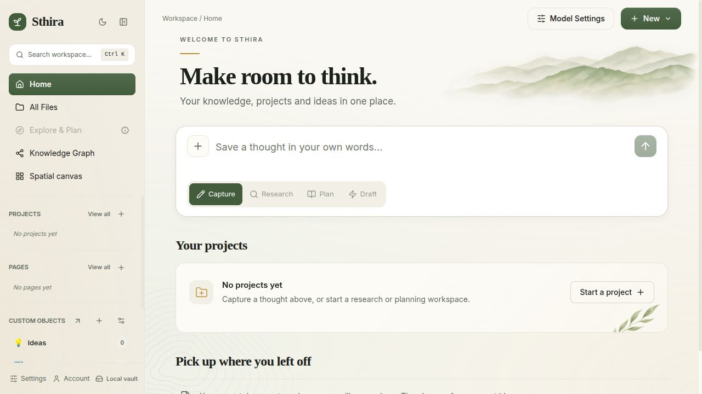

*These are fresh screenshots of the current browser preview, using synthetic documentation notes or built-in preview fixtures. They illustrate the interface; browser fallback data does not establish native vault persistence or successful AI execution. [Screenshot details](#about-the-screenshots).*

## Contents

- [What Sthira does](#what-sthira-does)
- [Features at a glance](#features-at-a-glance)
- [Install and run](#install-and-run)
- [Your first workspace](#your-first-workspace)
- [Writing, pages, and tabs](#writing-pages-and-tabs)
- [Projects, connections, and discovery](#projects-connections-and-discovery)
- [Objects, templates, and boards](#objects-templates-and-boards)
- [Set up AI](#set-up-ai)
- [Research, planning, and drafting](#research-planning-and-drafting)
- [Document conversation, Refine, and Derive](#document-conversation-refine-and-derive)
- [Resume and title suggestions](#resume-and-title-suggestions)
- [Shared memory](#shared-memory)
- [Workspace agent](#workspace-agent)
- [Keyboard shortcuts](#keyboard-shortcuts)
- [Storage, privacy, and backups](#storage-privacy-and-backups)
- [Import existing knowledge](#import-existing-knowledge)
- [Command-line usage](#command-line-usage)
- [Architecture and repository map](#architecture-and-repository-map)
- [Development and verification](#development-and-verification)
- [Troubleshooting](#troubleshooting)
- [Current limitations](#current-limitations)
- [Roadmap](#roadmap)
- [Documentation and contributing](#documentation-and-contributing)
- [About the screenshots](#about-the-screenshots)

## What Sthira does

Sthira is designed for personal knowledge work that develops over time: reading notes, research questions, project planning, decisions, and drafts. Its main building blocks are:

| Building block | Use it for |
| --- | --- |
| **Page** | A rich editable document stored as Markdown. Notes, imported sources, and structured objects share the document workspace. |
| **Project** | A purpose and a collection of related work. Opening a project shows its overview and contents. |
| **Typed object** | A page with a schema and properties, such as an Idea, Task, Decision, Source, or your own type. |
| **Connection** | An explicit reference between saved items, with outgoing links and backlinks. |
| **Canvas** | A spatial arrangement of cards and text for exploring ideas. |
| **Memory** | Intentional workspace/project/session context with attribution, sources, and revision history. |
| **Resume** | An explicit return to saved project context, with factual state and optional model-selected excerpts. |

Core writing and organization work without an AI connection. Research, Plan, Draft, and document-chat generation require an enabled workflow and an available model. Web research additionally uses a configured search provider.

## Features at a glance

These capabilities have implementations in the repository. Platform coverage and remaining verification are listed separately in [known limitations](docs/known-limitations.md).

| Area | Available capabilities |
| --- | --- |
| Capture | Save your words from Home without a model; create standalone or project pages. |
| Rich text | Headings, emphasis, lists, task checkboxes, tables, quotes, code, links, and image URLs in one Markdown-backed editor. |
| Save and history | Debounced autosave, manual save status, revisions, project history, and visible mirror-sync warnings with retry. |
| Navigation | Resizable/collapsible sidebar, pinned items, workspace search, directories, actionable breadcrumbs, and document tabs. |
| Projects | Purpose, factual counts, contents, search/filter/sort, list/grid layouts, pagination, and adding existing items. |
| Shared work | Attach one page to multiple projects while keeping one identity and content history. |
| References | Explicit connections, backlinks, nested read-only previews, internal links, and unlink/Undo. |
| Objects | Built-in/custom types, typed properties, object templates, table/list collections, and Kanban boards. |
| Visual exploration | Force-directed Knowledge Graph with search/filter/zoom, plus a separate spatial canvas. |
| AI connections | Guided Ollama/LM Studio setup, cloud providers, custom compatible endpoints, model discovery, and model selection. |
| Workflow controls | Separate Research, Plan, Draft, and document-chat switches, model defaults, and optional Research/Plan templates. |
| Research | Streaming synthesis using saved context and optional web retrieval; source inspection and Import to Vault. |
| AI editing | Document conversation, reviewable edit proposals, Refine, and Derive with source lineage. |
| Return to work | Factual Resume, optional source-validated model excerpts, cached reviews, and explicit refresh. |
| Workspace agent | Scoped goals, document chat, follow-ups, background tasks, reviewed pages/edits, Refine/Derive/titles/memory proposals, project memberships/page references, reviewed project creation/direction/moves, cancellation, and guarded undo. |
| Shared memory | Manual scoped context, search, pinning, attribution, source freshness, revisions, archive/restore, and model-free context preview. |
| Naming | On-demand title suggestions with model attribution and explicit acceptance. |
| Scheduled work | Research/Plan topic trackers, daily/weekly cadence, pause/resume, run-now, and saved digests. |
| Trust | Separate user/external/AI authorship, verified quotes, evidence attribution, and inspectable organizational proposals. |
| Storage | Local SQLite, Markdown mirrors, reconciliation, FTS5 indexing, and vector-search infrastructure through sqlite-vec. |
| Appearance | Light/dark themes, bundled watercolor landscapes, botanical accents, paper grain, contour textures, and neutral return-to-work language. |
| Migration | Reviewed Markdown/text imports, per-file selection, paginated history, optional agent guidance, provenance and guarded rollback. |
| CLI and MCP | Scoped JSON tools and local stdio MCP, revocable credentials, reviewed workspace proposals, plus owner storage/routing commands. |

## Install and run

### Prerequisites

Work from the repository directory containing `Cargo.toml` and `crates/` (the `sthira/` directory in this checkout).

- **Rust and Cargo:** current stable toolchain. The repository does not pin a minimum supported Rust version.
- **Node.js and npm:** use Node 22.22.2+ on the Node 22 line for the current locked UI/test dependencies; Node 22.23.2 is used in this workspace. Install from the committed npm lockfile.
- **Tauri CLI 2:** needed for native development and embedded-asset builds.
- **Native development libraries:** Tauri's platform prerequisites. Linux needs WebKitGTK 4.1 and GTK development packages; Windows needs C++ build tools and WebView2, and macOS needs Xcode command-line tools. Non-Linux builds still need platform validation.
- **SQLite:** bundled by `rusqlite`; no separate database server is needed.

On Debian/Ubuntu-family Linux, the desktop dependencies include:

```bash
sudo apt update
sudo apt install build-essential curl wget file libssl-dev \
  libwebkit2gtk-4.1-dev libgtk-3-dev \
  libayatana-appindicator3-dev librsvg2-dev
```

### Set up dependencies

From the repository root:

```bash
rustc --version
cargo --version
node --version
npm --version

npm ci --prefix crates/sthira-desktop/ui
cargo install tauri-cli --version '^2' --locked
```

Skip the CLI installation if `cargo tauri --version` already reports version 2.

### Run the native desktop app

```bash
cd crates/sthira-desktop
cargo tauri dev
```

Run the CLI from the desktop crate, where `tauri.conf.json` lives. It starts the frontend hook in `ui/`, serves Vite on port **1420**, and opens the Tauri window. The frontend package has no `tauri` npm script; use `cargo tauri` directly.

To try the app with a disposable vault on Linux/macOS, use this instead from the same desktop crate directory:

```bash
demo_vault_dir="$(mktemp -d "${TMPDIR:-/tmp}/sthira-demo.XXXXXX")"
env -u STHIRA_SEED_DEMO STHIRA_VAULT_DIR="$demo_vault_dir" cargo tauri dev
```

### Build an executable with embedded frontend assets

From `crates/sthira-desktop` (the frontend build hook runs in `ui/`):

```bash
# Debug executable, usable without a running Vite server
cargo tauri build --debug --no-bundle --ci

# Release executable
cargo tauri build --no-bundle --ci
```

With the default Cargo target directory, the executables are `target/debug/sthira-desktop` and `target/release/sthira-desktop` relative to the repository root (`.exe` on Windows).

The current Tauri configuration disables installer bundling. These commands build executables, not packaged installers. Plain `cargo build`/`cargo test` is useful for Rust development but does not establish that a standalone binary includes Tauri's `custom-protocol` frontend assets; use the Tauri build command for that purpose.

### Browser preview

```bash
# From the repository root
npm run dev --prefix crates/sthira-desktop/ui
```

Open `http://localhost:1420`. This is a **UI development preview** with browser fallback APIs. Some screens use sample data or empty results, and some operations are placeholders or session-only. Use the native app for durable vault workflows and real provider execution.

## Your first workspace

1. Open **Home**, leave the composer in **Capture**, and write a thought. Submit it to save your words without an AI model.
2. Choose **New Project** in the sidebar or **Start a project** on Home. Give it a name and optional purpose.
3. Open the project overview and choose **New page**, or **Add existing** to reuse saved material.
4. Edit the title and body. Watch the save indicator before closing the app; click it to save manually.
5. Use **Connections → Link an item** to relate pages without copying them.
6. Return through the project overview and choose **Resume** when you want working context.

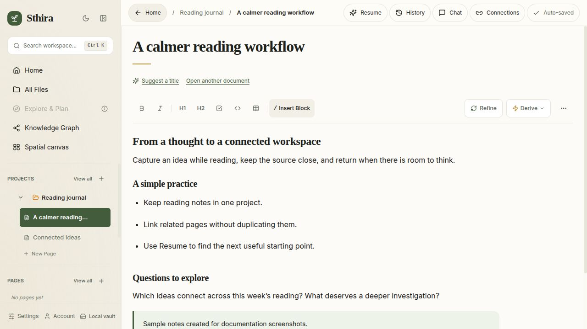

## Writing, pages, and tabs

Pages have one formatted, editable surface. Markdown is the durable content format; there is no separate Edit/Preview mode. Use the toolbar or type `/` at a supported block boundary to open the command menu. Autosave runs after roughly **600 ms** of inactivity; navigation also attempts to save dirty content.

| Command family | Examples |
| --- | --- |
| Formatting | `/h1`, `/h2`, `/h3`, `/todo`, `/bullet`, `/table`, `/code`, `/callout`, `/divider` |
| Workspace creation | `/new page`, `/new project`, `/new custom object` |
| Typed objects | `/idea`, `/new idea`, `/task`, and commands for saved custom types |
| Knowledge actions | `/decision`, `/question` |
| AI actions | `/plan`, `/research`, `/expand`, when the relevant configuration is ready |

The menu supports filtering, arrow keys, Enter, and Escape. A checked task is document content; it does not by itself approve a proposal or execute an external action.

Ordinary navigation reuses the active document tab. **Ctrl/Cmd-click** a document or choose **Open another document** for another context. The tab strip appears when multiple documents are open. Closing a tab closes its working context, not the saved document. Each context retains its project association, scroll position, and conversation draft where supported.

Use **Page actions (⋯)** for Link/Move to Project, Detach from Project, Duplicate Note, Convert to Object Type, Copy Markdown, Copy Note Link, and deletion. Rename through the editable title or a Rename menu entry where offered. Sidebar controls also let you pin frequently used pages/projects. Duplication creates a separate document; linking an existing page preserves shared identity.

For project deletion, review the impact dialog: the default keeps pages as unassociated notes. The optional cascade deletes exclusive content while retaining pages shared with other projects. Do not assume every destructive operation has an Undo path.

Change theme with the sidebar toggle or **Settings → Appearance**, which also offers system appearance. **Account** currently shows local identity/integrity information rather than a hosted sign-in or synchronization account.

<details>
<summary>See document tabs and slash commands</summary>

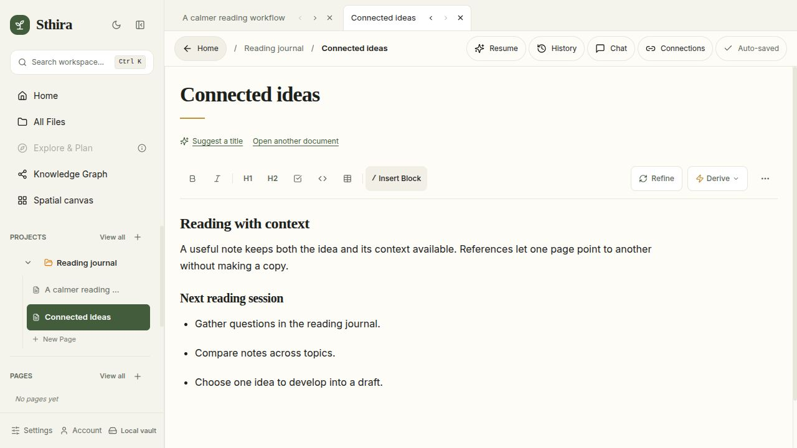

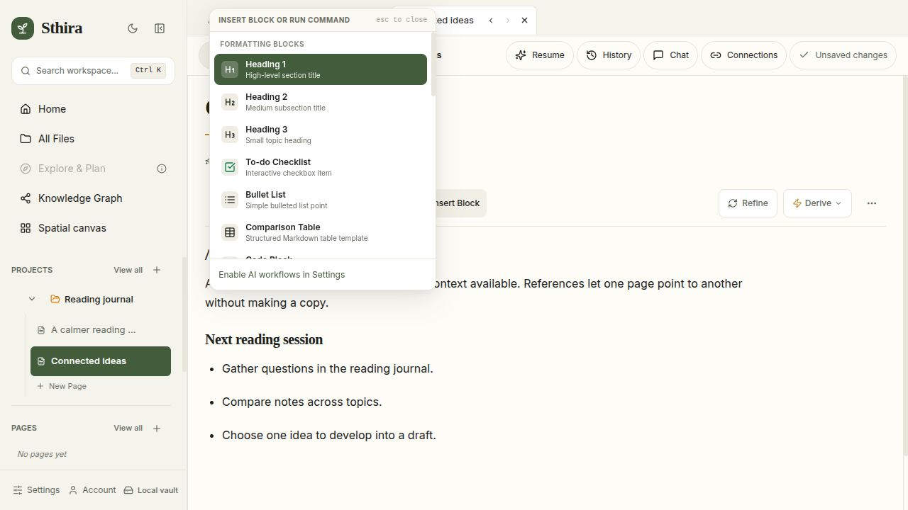

</details>

## Projects, connections, and discovery

Opening a project shows its purpose and contents rather than automatically selecting a note or running AI. Search its loaded titles/summaries, combine type and relationship filters, change sort order, or switch list/grid layout. **Add existing** attaches a saved item without duplicating its text or history.

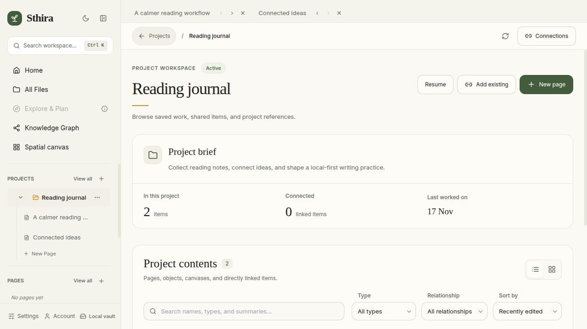

Use **All Files** for the workspace directory and its Projects, Pages, and Custom Objects categories. Scope filters distinguish project items from standalone items. Workspace search also resolves exact IDs and supported copied internal URLs.

These relationships mean different things:

| Relationship | Meaning |
| --- | --- |
| Project membership | A page belongs to a project; it may belong to several. |
| Manual connection | One item explicitly references another. Backlinks show incoming references. |
| Derivation | A new page came from another through Derive; source lineage is retained. |
| Spatial placement | A card's canvas position; moving it creates no knowledge relationship. |
| AI proposal | A suggested organizational change awaiting your decision. |

In **Connections**, choose **Link an item**, search, and select a target. Open a connection as a read-only preview, follow its trail, or open the exact item centrally. **Insert in page** inserts an internal link at the editor selection. Removing a connection preserves both documents; use Undo when offered.

Internal references support `sthira://artifact/<id>`, `sthira://project/<id>`, and compatible `#/sthira/...` links. In-app rendering works independently of OS-level URL-scheme registration.

<details>
<summary>See connections and Knowledge Graph</summary>

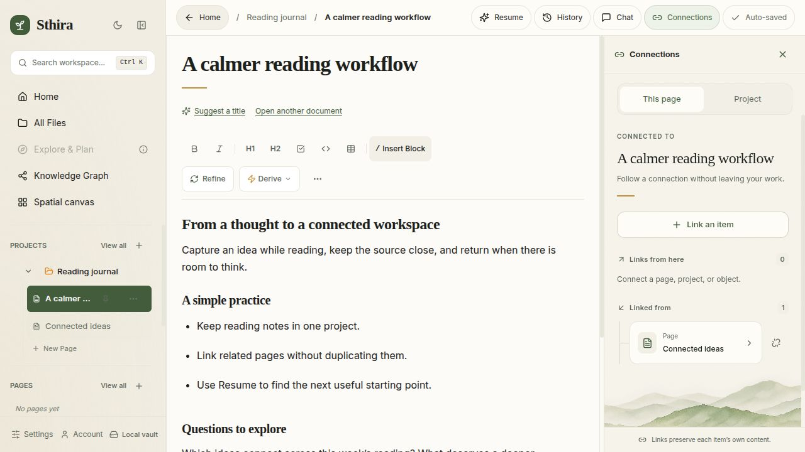

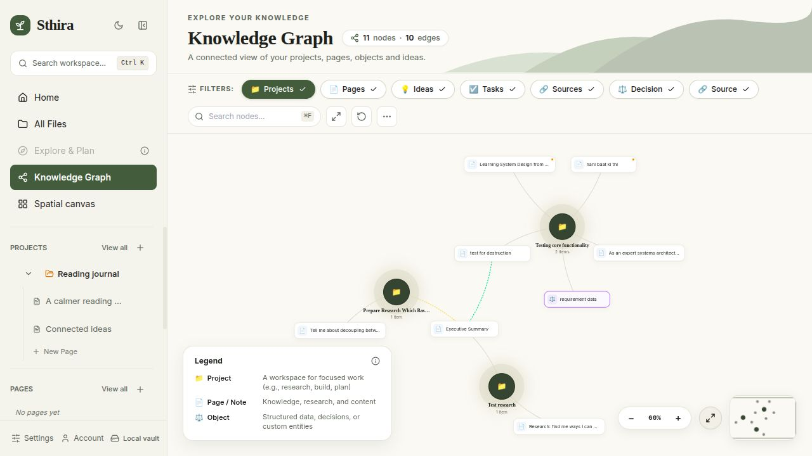

*The graph screenshot uses the browser's fixed sample graph, separate from the reading-journal example. In the native app, topology comes from the vault.*

</details>

Open **Knowledge Graph** to explore nodes and relationships using filters, search, pan, zoom, and Fit to View. Open **Spatial canvas** to arrange saved items and text visually; layout is independent of references, project membership, and evidence.

## Objects, templates, and boards

Built-in types include **Idea**, **Task**, **Decision**, and **Source**. A type adds structured properties around a document; it does not require a second editor.

1. Choose **New Object Type** beside Custom Objects, or use `/new custom object`.
2. Set the display name, identifier, icon, and accent color.
3. Add properties. The current builder exposes **Text, Number, Checkbox, Select, Date, and URL** fields; define options for Select fields.
4. Create the type, then create instances from its collection or slash command.
5. Use **Manage Object Types & Templates** for object schemas and reusable object templates.

Collections provide table/list views and Kanban boards; boards use suitable select properties for grouping. Object templates create independent content. Reusing an existing object across projects preserves its identity. The object-template manager is separate from **Settings → Templates**, which manages Research/Plan synthesis templates and optional model-free Capture structures. See [synthesis templates](docs/features/synthesis-templates.md).

<details>
<summary>See the custom object type builder</summary>

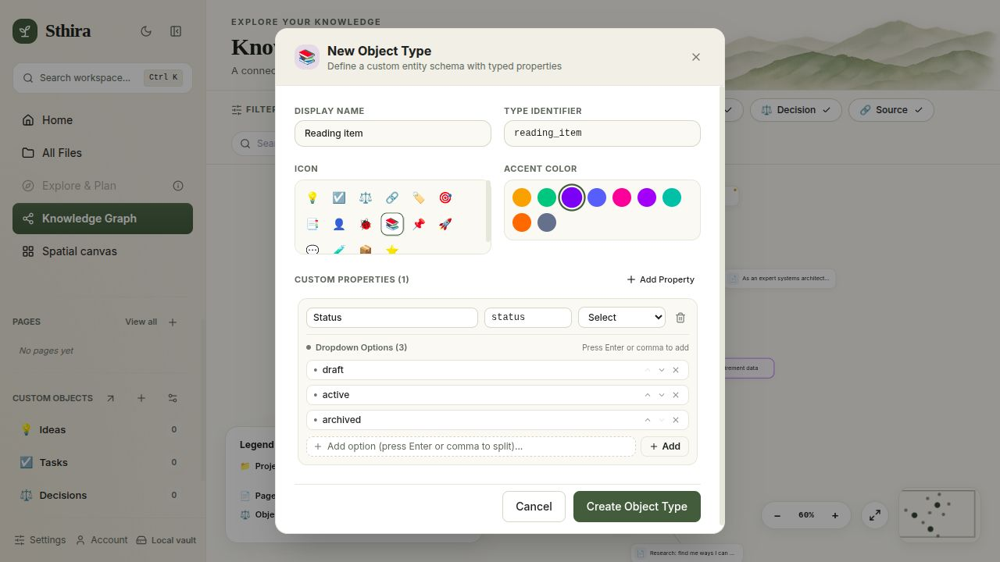

</details>

## Set up AI

### Connect a model

1. Open **Settings → AI & Models → Set up AI**.
2. Choose **Ollama**, **LM Studio**, **Custom connection**, or a listed cloud provider: OpenAI, Anthropic, OpenRouter, Groq, or DeepSeek.
3. Start the external app/server and make a text model available there, or enter the cloud endpoint and API key. Sthira's external-app guide does not install the app or download its models.
4. Enter the server address and choose **Check connection**. A reachable server with no discovered models is different from a generation-ready model.
5. Choose a discovered model, save the connection, and set a workspace default as needed. Custom connections require the matching API format.

Ollama accepts a server root, native `/api` base, or compatibility `/v1` base; reverse-proxy prefixes are supported. A local server commonly uses `http://localhost:11434`. See [Ollama connections](docs/features/ollama-connections.md).

### Enable the workflows you want

Open **Settings → Workflows** and enable Research, Plan, Draft, and/or Document chat. Each can inherit the workspace default or use its own model. An explicit task/document selection takes precedence, followed by the workflow default and then the workspace default. An unavailable explicit selection produces an error rather than silently choosing another model.

Workflow preferences save immediately. Connection edits have explicit Save buttons. Enabling a workflow does not establish that its endpoint can successfully generate.

<details>
<summary>See AI setup and workflow settings</summary>

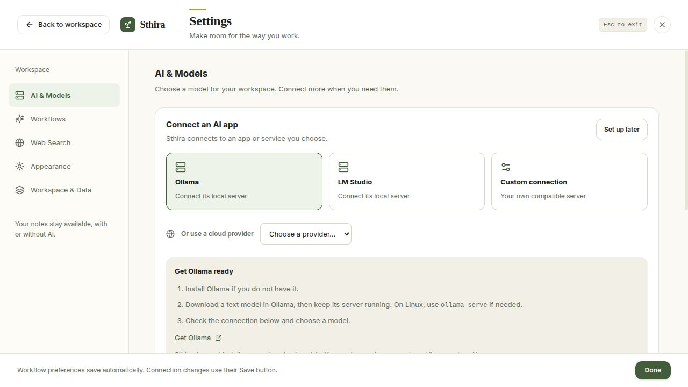

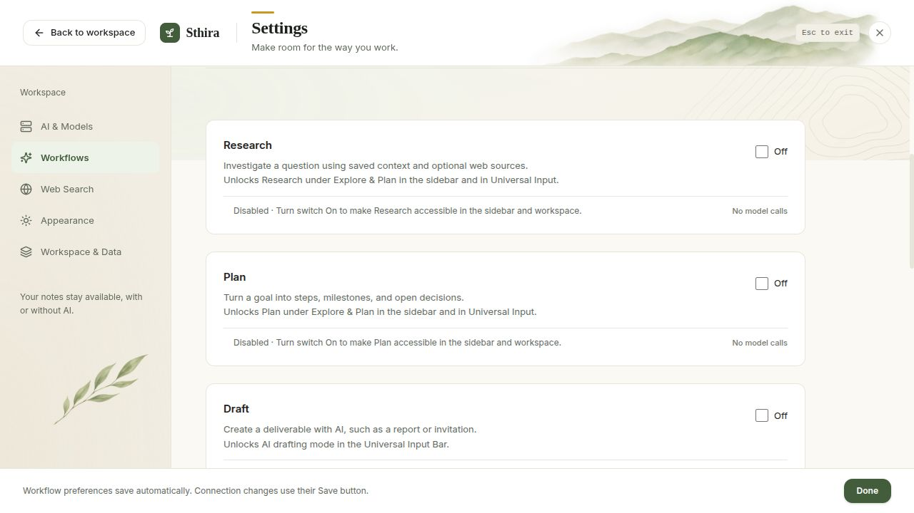

</details>

### Configure web search separately

Open **Settings → Web Search**. Choose an enabled primary provider, enter its endpoint/key, save, and use **Test Search** to check retrieval.

| Provider | Setup |
| --- | --- |
| DuckDuckGo HTML | No API key; susceptible to anti-bot challenges and availability changes. |
| SearXNG | Your own reachable instance with a working JSON search endpoint. |
| Brave Search | API endpoint and key. |
| Tavily | API endpoint and key. |

**Test Search tests retrieval only.** Research also needs an enabled workflow and working model. With all search providers disabled, research can use local vault context without external search. A self-hosted search proxy may still query external engines, depending on its configuration.

<details>
<summary>See web search settings</summary>

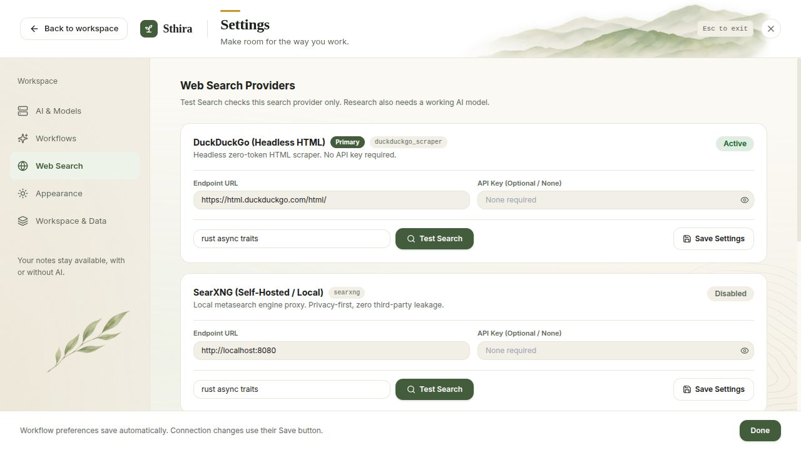

</details>

## Research, planning, and drafting

| Mode | What to enter | Intended result |
| --- | --- | --- |
| Capture | A thought in your words | A user-authored note, with no model required. |
| Research | A question or topic | A streamed investigation with saved context and optional web sources. |
| Plan | A goal and constraints | Steps, milestones, risks, and open decisions. |
| Draft | A deliverable request | AI-authored prose such as a report, invitation, or working draft. |

Choose the mode on Home, select the available model and relevant web/template options, and submit. **Explore & Plan** provides a dedicated workspace for Research, Plan, Trackers, and Digests once its workflow/model requirements are ready. Research and Plan use the central workspace and ordinary rich text, with Markdown as durable content.

Inspect source attribution through **Page actions → Sources & insights**. Use **Import to Vault** on retrieved material to retain an external source artifact for later reading. Search results and snippets alone are not the same as a saved source.

Search challenges, rate limits, empty results, and model failures are surfaced separately. If retrieval fails, a result may be labeled as local-vault synthesis or unverified model knowledge; that is not externally grounded research. Review claims against the actual saved sources.

For recurring topics, create a Research/Plan tracker with the desired cadence and destination. Existing trackers support daily/weekly scheduling, pause/resume, and run-now; outputs appear as saved digests. The scheduler runs with the desktop process, so this is not an always-on hosted service. Disabling the corresponding workflow pauses scheduled work; deleting a tracker preserves its prior digests.

## Document conversation, Refine, and Derive

**Chat** opens an agent-powered conversation attached to the saved document. Enable Document chat and select an available model, then ask a question or request an edit. Sthira saves the draft before queueing the request and uses that note plus bounded prior conversation. Existing messages and model attribution remain intact. Document chat grants no implicit access to other pages or live web/external tools.

To request a change, enable **Suggest a document edit**. Inspect current and proposed documents in the review comparison, then choose Apply or Dismiss. Application checks for stale source content and records a reversible change. A discussion reply by itself does not edit the page. Keep writing, close chat or switch documents while the task runs; **View agent activity** and **Stop agent task** remain available. Model choice is remembered per document, and saved replies retain producing-model attribution.

**Refine** updates the current document using your critique, with revision/restore protections. **Derive** creates a separate page from saved source content and records lineage. An explicit destination project controls where a derived page belongs; shared sources without unambiguous context stay standalone. Save failures and provider errors must not be presented as completed edits.

<details>
<summary>See document conversation before AI setup</summary>

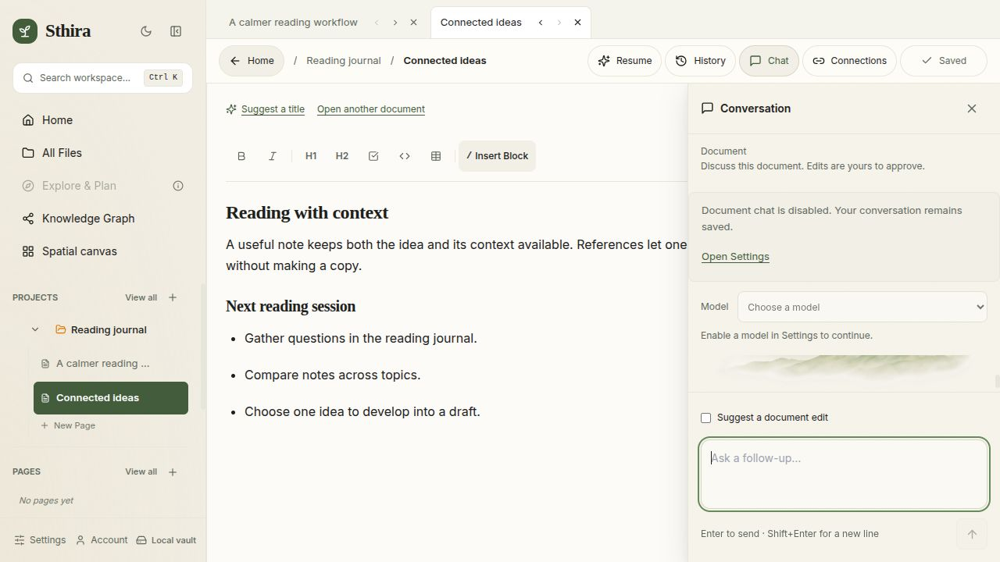

</details>

## Resume and title suggestions

Choose **Resume** from an existing project overview or project document. Factual working state remains available without AI. The compact orientation is bounded to 75 visible words; expanded review provides more context. Opening Resume or reading a valid cached review does not itself dispatch a model.

For optional model-selected excerpts, open **Settings → Workflows → Resume**, enable model summaries, select source details/document limits, and choose the model. Then explicitly use **Summarize** or **Refresh summary** in Resume. Excerpts must match saved source text; current facts remain separately available. The shared cache accounts for source revisions, settings, and generator identity.

The optional **Local Resume pack** downloads an app-managed runtime and SmolLM2-360M model only on request (about 410 MB of download data). It is a preview with limited quality, primarily for English, separate from Ollama/LM Studio connections. There is no continuous background summary generation. See [Resume behavior and pack details](docs/features/resume.md).

**Suggest a title** reads a bounded saved excerpt and offers reviewable names using the configured Resume model or an explicit override. Generation does not rename the document. Choose **Use title** to accept; changed source content or a manually changed title can invalidate a suggestion. Small local models may produce misleading wording, so review names before accepting. See [title suggestions](docs/features/title-suggestions.md).

## Shared memory

Open **Memory** in the sidebar, choose **New memory**, and write something worth carrying forward: a preference, a project constraint, or an unresolved question. Choose Workspace, an existing Project, or a Session identifier, optionally pin it and select saved source pages, then **Save memory**. No model is required.

Search titles/content and filter by scope. Select a memory to edit it, inspect original attribution and **History**, or **Archive memory**. Use **Include archived** and **Restore memory** to return it to active context. Scope and captured sources stay fixed; create a new memory to change its source basis. Failed or conflicting saves retain your draft.

**Preview shared context** shows up to 8 eligible entries and 8,000 serialized characters without a model call. Archived entries, unavailable projects, and memories with changed/unavailable sources are excluded. Archive preserves content/history. Desktop memories persist in the vault database; browser preview memories reset on reload. The native workspace agent reads eligible entries within its grants; other existing AI workflows do not use this store automatically. See [shared memory details and limits](docs/features/shared-memory.md).

## Workspace agent

Enable **Workspace agent** in **Settings → Workflows** and choose an enabled model. Open **Agent** in the sidebar, describe your goal, choose Entire workspace or a project, and select the model connection. Workspace-wide memory is a separate optional grant. Selected context is sent to that connection only after **Start working**.

The agent can search/read saved pages, use eligible shared memory, prepare pages and edits, and propose **Refine, Derive, title suggestions and shared-memory updates**. Follow its activity, inspect the result and saved handoff, then **Review proposal** and explicitly Create/Apply or Dismiss. Applied document edits support guarded undo. **Stop run** cancels active work; unfinished runs remain visible as interrupted after startup. Saved runs do not restart themselves.

Use **Continue this conversation** on a saved run to send a follow-up with the same scope and bounded prior context. Each turn keeps its own model, activity and proposal decisions. The checklist icon beside **Agent** opens **Agent tasks** from any view, including the collapsed sidebar: inspect progress, open a result or its original document, or stop a task. You can navigate and keep editing while work continues. Up to three tasks may be active, with one per conversation; background execution requires the desktop app to remain open.

For project organization, ask “Add my release research page to Release planning and propose a reference to its risks page.” The agent can inspect project metadata and prepare reviewed membership/reference changes. These preserve page identity, content and unrelated relationships, with guarded **Undo organization change**. See [organization usage and scope](docs/features/agent-organization.md).

You can also ask “Create a Release planning project,” “Clarify this project’s purpose,” or “Move this page from Research to Release planning.” Project creation and moves require **Entire workspace**; purpose updates stay within the selected scope and retain AI provenance. Review before applying, then use guarded **Undo project change** where eligible. New project identities become available after acceptance for follow-up work. See [project workflow usage and recovery](docs/features/agent-project-workflows.md).

External agents can now connect through a scoped JSON CLI API or local stdio MCP server. They can read authorized pages/memory and prepare the same reviewed workspace proposals. Connection revocation and owner approval stay separate from model tools. See [CLI/MCP setup, schemas and examples](docs/features/cli-and-mcp.md).

For deliberate task transfers, use **Saved handoffs** in a finished workspace run: choose a scoped connection and source references, inspect external contributions and their review states, then **Continue in Sthira** with an available model. Source changes are visible and rechecked. See [cross-agent continuity](docs/features/cross-agent-continuity.md).

For example, ask “Refine my research note, derive an execution plan, suggest clearer titles, and propose a project memory of the open questions.” Refine retains its guarded restore path; Derive records source lineage; title review requires choosing a saved suggestion; memory changes preserve authorship, source evidence and revision history. All require explicit review. See [workflow proposal usage and recovery](docs/features/agent-workflow-proposals.md).

The agent works with saved local knowledge and can now also prepare reviewable Research or Plan pages, using configured templates and an explicit, default-off web-research grant. It has no shell, terminal, or filesystem tools, and uses bounded work rather than unlimited autonomous execution. Generated research/plans are proposals until you apply them; web failures and local-only grounding are labelled honestly. Browser preview does not simulate successful runs. See [agent setup, scope, limits, and lifecycle](docs/features/workspace-agent.md), [synthesis templates and agent Research/Plan](docs/features/synthesis-templates.md), and [document conversations/background tasks](docs/features/agent-conversations-and-tasks.md).

## Keyboard shortcuts

| Action | Shortcut/control |
| --- | --- |
| Workspace search | Ctrl/Cmd + K |
| Submit Home input | Enter |
| New line in Home input | Shift + Enter |
| Switch composer modes | Tab in the composer; Escape moves to mode controls |
| Open another document context | Ctrl/Cmd-click a document, or Open another document |
| Cycle tabs | Ctrl/Cmd + Tab; add Shift to reverse |
| Close active document tab | Ctrl/Cmd + W, where the host allows interception |
| Navigate focused tab strip | Arrow keys, Home, End |
| Bold / italic | Ctrl/Cmd + B / I in the editor |
| Open insert menu | `/` at a block boundary, or Insert Block |
| Choose/dismiss menu item | Arrow keys + Enter / Escape |
| Graph search | Ctrl/Cmd + F when outside a text input |
| Send chat / insert newline | Enter / Shift + Enter |

Modal and host-browser shortcuts can take precedence. [Document tabs](docs/features/document-tabs.md) describes save guards and session scope.

## Storage, privacy, and backups

### Where your work lives

The native executable opens **`$HOME/.sthira/vault`** by default, or the exact directory supplied through **`STHIRA_VAULT_DIR`**. The database and document mirrors live under that vault root:

```text
~/.sthira/
├── vault/
│   ├── sthira.db              # Documents, relationships, history, settings, conversations, memories
│   ├── sthira.db-wal          # SQLite sidecar while applicable
│   ├── sthira.db-shm          # SQLite sidecar while applicable
│   └── <artifact-id>.md       # Markdown with identity/authorship frontmatter
└── .sthira_meta/
    └── memory_mirrors/        # Derived memory exports, when generated
```

The legacy CLI defaults differ: `./sthira.db` and `./.sthira_vault/artifacts`. Use `--workspace /absolute/path/to/vault` for the native layout, or supply **both** `--db` and `--vault` for separate paths; changing `STHIRA_VAULT_DIR` alone does not configure the CLI. Derived-memory paths depend on the vault layout; the standard native layout uses the sibling directory shown above.

Markdown files are portable content; SQLite retains additional state such as connections, project membership, properties, revisions, and conversations. Keep frontmatter IDs intact when editing files externally. Reconciliation detects imports, renames, and conflicting external changes; it is not multi-device synchronization. Derived memory is marked `STHIRA_DERIVED_MEMORY: DO_NOT_INGEST` and excluded from normal ingestion to avoid recursively treating summaries as original notes.

### Privacy boundaries

Core capture, reading, and editing use local storage. AI and web requests send selected prompts/context or search queries to configured endpoints. A localhost address alone does not prove on-device processing, especially for cloud-backed models exposed by local software. Scheduled trackers are an explicit source of recurring requests while enabled.

The current implementation stores provider/search credentials in the local database; UI masking is not database encryption. Protect vault files and backups accordingly. Markdown images are URL references: local attachment management and automatic offline image caching are not implemented.

### Back up and restore

1. Wait for the save indicator to confirm saving, then close Sthira and any CLI process using the vault.
2. Copy the **whole vault directory** and, if needed, its sibling `.sthira_meta` directory to your backup destination. Copying only `.md` files omits relationships, history, and settings. For a live-database backup, use a SQLite-aware backup method rather than copying only the main database file.
3. Restore into a separate directory and launch with `STHIRA_VAULT_DIR` pointing to its vault root. Verify it before replacing your usual copy.

Tab metadata and some panel/theme preferences use WebView-local storage. A vault backup does not guarantee restoration of every UI preference or unsent draft. Text typed immediately before termination, before autosave completes, may be lost. **Reset Vault** in Settings is destructive, not a backup or recovery feature.

## Import existing knowledge

Open **Settings → Workspace & Data → Import existing knowledge** to inventory and review local Notion Markdown, Obsidian Markdown, Google Docs Markdown/plain text or other text exports. Choose individual documents, inspect selection-specific previews and optionally request migration-agent guidance. Source excerpts are opt-in, suggestions require review, and history loads paginated summaries. Source files remain untouched; duplicate and changed-source conflicts stay visible. See [migration formats, limits and recovery](docs/features/migration.md).

## Command-line usage

From the repository root:

```bash
cargo run --locked -p sthira-cli --bin sthira-cli -- --help
```

To keep examples isolated from your desktop vault, create a temporary CLI workspace on Linux/macOS:

```bash
cli_demo_dir="$(mktemp -d "${TMPDIR:-/tmp}/sthira-cli-demo.XXXXXX")"
cargo build --locked -p sthira-cli --bin sthira-cli

# Options go BEFORE the command.
./target/debug/sthira-cli --db "$cli_demo_dir/sthira.db" \
  --vault "$cli_demo_dir/artifacts" init

./target/debug/sthira-cli --db "$cli_demo_dir/sthira.db" \
  --vault "$cli_demo_dir/artifacts" capture "Compare approaches for a reading journal."

./target/debug/sthira-cli --db "$cli_demo_dir/sthira.db" \
  --vault "$cli_demo_dir/artifacts" project new "Reading journal" "Collect and connect reading notes"

./target/debug/sthira-cli --db "$cli_demo_dir/sthira.db" \
  --vault "$cli_demo_dir/artifacts" project list
```

Use the same `--db` and `--vault` before each additional command:

| Command | Purpose |
| --- | --- |
| `init` | Explicitly initialize a new workspace; existing commands require an existing vault. |
| `api schema` / `api call TOOL JSON` | Discover and call scoped JSON tools. |
| `mcp` | Serve authenticated local stdio MCP. |
| `access grant` / `list` / `revoke` | Manage external connections as the local owner. |
| `review show` / `apply` / `dismiss` / `undo` | Inspect and decide saved proposals as the local owner. |
| `home` | List threads, loose captures, and pending proposal count. |
| `capture "text"` | Save a user-authored note. |
| `route "query"` | Classify intent through the read-only router. |
| `project new "name" "purpose"` | Create a project. |
| `project list` | List projects and full IDs. |
| `resume PROJECT_ID 1` / `resume PROJECT_ID 2` | Invoke the legacy core brief path. |
| `history PROJECT_ID` | Inspect project milestones and history. |
| `reconcile` | Reconcile Markdown and database state; this can write/import files. |
| `audit` | Invoke the separate live Ollama model-audit binary; requires its runtime setup. |

The legacy storage/routing commands use deterministic embeddings and report that CLI generation has no configured provider; they are not a headless equivalent of the desktop's configured AI workflows. CLI Resume also differs from the newer desktop factual/extractive implementation. The authenticated JSON API and stdio MCP server accept work from an external agent without dispatching a local model. See [connection setup, tool schemas, examples and owner review](docs/features/cli-and-mcp.md).

## Architecture and repository map

React calls typed Tauri IPC handlers in the desktop crate. Those handlers use the Rust core for transactions, document storage, relationships, knowledge extraction, research, model dispatch, and scheduling. The core combines bundled SQLite, FTS5 indexes, and sqlite-vec infrastructure with readable Markdown mirrors.

Authorship and evidence origin are distinct: user-authored, external, and AI-generated content retain their identity, while claims are classified as user-recorded, source-backed, or AI-inferred using authorship and verified quotes. A speculative question is not automatically a recorded decision. Organizational suggestions stay proposals until accepted or dismissed.

```text
.
├── Cargo.toml / Cargo.lock       # Rust workspace and dependency lock
├── crates/
│   ├── sthira-core/             # Storage, knowledge, models, research, memory, graph
│   ├── sthira-desktop/          # Native entry point, Tauri IPC, scheduler
│   │   ├── src/
│   │   ├── tests/               # Native handler/engine integration suites
│   │   ├── resources/resume/    # Optional pack metadata and notices
│   │   ├── tauri.conf.json
│   │   └── ui/                 # React + TypeScript + TipTap + Tailwind + Vite
│   │       └── src/test/        # Vitest component/integration suites
│   ├── sthira-cli/              # Storage CLI and evaluation binaries
│   └── sthira-testkit/          # Fake clock and deterministic test model
├── tests/frozen/                # Acceptance and metamorphic contracts
├── fixtures/                    # Frozen inputs and evaluation cases
├── xtask/                       # Phase gates and invariant scanners
├── docs/
│   ├── policies/               # Product/design/verification rules
│   ├── features/               # Feature-specific behavior
│   ├── design/                 # Design system and approved targets
│   ├── images/                 # README product screenshots
│   └── known-limitations.md     # Outstanding implementation/verification
└── tmp/verification/            # Ignored disposable execution evidence
```

## Development and verification

Run checks from the repository root unless specified. Use isolated vaults for experiments; do not seed/reset your everyday vault.

```bash
# Rust workspace
cargo build --locked --workspace
cargo test --locked --workspace --no-fail-fast -- --test-threads=1
cargo clippy --workspace --all-targets -- -D warnings
cargo fmt --all -- --check

# UI
npm test --prefix crates/sthira-desktop/ui
npm run build --prefix crates/sthira-desktop/ui

# Patch whitespace
git diff --check
```

The serial Rust command helps avoid known load sensitivity in timing assertions; it does not replace native GUI or live-provider checks. The current UI build emits bundle-size and mixed static/dynamic import advisories.

Phase gates run with `cargo run --locked -p xtask -- gate N`:

| Gate | Coverage |
| --- | --- |
| 1 | Storage and reconciliation |
| 2 | Epistemic/authorship safety |
| 3 | Router isolation |
| 4 | Cached resumption and Home |
| 5 | Project history |
| 6 | Cross-project discovery and proposals |
| 7 | Multi-project lifecycle simulation |
| 9 | Workflow modes and registry |

There is no gate 8 in the current mapping. Generated gate reports and per-run screenshots belong in ignored temporary output. Component tests, engine integration, browser preview, native GUI, and live-provider checks establish different things; see the [verification policy](docs/policies/verification.md).

## Troubleshooting

| Symptom | What to check |
| --- | --- |
| `npm run tauri` fails | The UI has no such script. Install Tauri CLI 2 and run `cargo tauri dev` from `crates/sthira-desktop`. |
| Tauri cannot recognize the project | Run it from the directory containing `tauri.conf.json`, not from its `ui/` child directory. |
| `cargo tauri` is unavailable | Check the Cargo bin directory is on `PATH` and install `tauri-cli` 2. |
| Build cannot find WebKitGTK/GTK | Install native development libraries; Linux uses WebKitGTK 4.1. |
| Port 1420 is in use | Stop the old Vite process or app using the port; Vite uses `strictPort`. |
| Standalone binary expects localhost | Build through `cargo tauri build`; plain Cargo debug/test binaries may expect Vite. |
| Research/Plan/Draft/chat is disabled | Enable the workflow and select an available model in Settings. |
| Connection finds no models | Make a model available in the external app, check its address/API format, and discover again. |
| Search passes but Research fails | Retrieval and generation are separate. Check the selected model, authentication, and actual error. |
| Search is blocked or rate-limited | Review the error, use another available provider, or use explicitly labeled local context. |
| Model returns unreadable output | Retry or choose a model that follows the required format. A failed request is not a completed edit. |
| `Saved (mirror warning)` | SQLite saved the page but its Markdown mirror/bookkeeping needs repair. Check permissions/disk space and use Retry mirror sync. |
| CLI and desktop show different notes | Defaults differ. Use `--workspace` or set both CLI paths to the actual intended vault. |
| Browser loses notes or shows samples | Fallback APIs are incomplete. Use native execution for persistence and real models. |

## Current limitations

The authoritative list is [docs/known-limitations.md](docs/known-limitations.md). In particular:

- **Preview versus native:** screenshots and mocked tests do not certify native save/restart behavior. Expanded slash-creation entry points have specific native persistence follow-ups.
- **Platform scope:** Linux has the most recorded execution coverage. Other native builds and local-pack platform runtimes need validation.
- **AI quality/grounding:** small models can fail strict formats or suggest poor titles. The local Resume pack is an extractive preview, not a completeness/accuracy guarantee. Native live-provider Research has reached a reviewed, accepted, web-backed page with navigable citations. Deterministic fixtures now cover the wrapped Inkling follow-up action and accepted Research-to-Plan lineage; live ordinary-language Plan generation and direct web Research remain deferred verification items.
- **Media:** image URLs work; binary clipboard image paste, managed attachments, and automatic offline image caching remain unimplemented.
- **Session recovery:** tabs exist; split panes, tab groups, and detached windows do not. Edits before the autosave boundary are not crash recovery.
- **Links/accessibility:** in-app references and keyboard controls have coverage; OS URL registration, external browser launch, and interactive screen-reader speech need separate validation.
- **Scope:** document chat uses saved-document context/recent history without fresh web/tools. Trackers need the desktop running. Background Resume/naming is not implemented.

## Roadmap

### Next implementation phases

The AE5 migration-agent/review completion batch is implemented. Guided onboarding (UX1) is next, followed by coworking. UX/CW capabilities below are **planned, not implemented**; native/live acceptance gaps remain separately tracked. Personal local work will remain available offline without login; shared workspaces will require sign-in and membership. See the [completion, onboarding and coworking plan](docs/onboarding-and-cowork-plan.md).

| Phase | Planned outcome |
| --- | --- |
| AE5 completion batch — implemented | Migration-agent guidance, selective per-document review, lightweight/paginated history and synthetic export/recovery tests. |
| UX1 — Guided onboarding and Help | Optional, replayable application tour; offline searchable documentation, contextual help and a shortcut reference. |
| CW1 — Accounts and workspace membership | Sign-in/recovery/session management, team workspaces, invitations, members and roles. |
| CW2 — Shared work and synchronization | Shared projects/pages, comments, attributed activity, reviewed changes and conflict-safe synchronization. |

The owner selected asynchronous shared work for the first coworking release. CW3 adds live co-editing, presence and collaborator cursors afterward; its schedule remains open. Hosting and authentication/synchronization providers will be chosen during the collaboration design.

### Agent Extension foundations

The five **Agent Extension phases AE1–AE5** remain separate from the original phases 1–25 and the new UX/CW phases. The [extension plan](docs/agent-extension-plan.md) defines scope and acceptance criteria. AE1 has the shared-memory foundation, AE2 has the native workspace agent described above, AE3 has a local CLI/MCP adapter foundation, and AE4 has explicit saved handoffs and native continuation; AE5 has a reviewed local-export migration foundation. Native GUI verification limits are tracked separately, and no release dates are promised.

| Phase | Milestone | Intended outcome |
| --- | --- | --- |
| AE1 | Shared memory and shared actions | Initial memory UI and shared core actions implemented; scoped context, attribution, history, and source freshness. Native GUI follow-up remains. |
| AE2 | Native workspace agent | Scoped agent, document chat, follow-ups, background tasks, reviewed pages/edits, Refine/Derive/titles/memory proposals, reviewed memberships/references/project creation/direction/moves, cancellation, and guarded undo implemented; native GUI/live-provider follow-up remains. |
| AE3 | CLI and MCP access | Local scoped/revocable CLI and stdio MCP adapters, shared proposals and owner review implemented; native GUI/client/platform follow-up remains. |
| AE4 | Cross-agent continuity | Explicit saved handoffs, scoped external contributions, current source/review state and owner-controlled native continuation implemented; native GUI/live-client follow-up remains. |
| AE5 | Migration system and agent | Reviewed local Markdown/text imports, selective previews, scoped model guidance, paginated history, provenance, retry receipts and guarded rollback implemented; connectors and rich formats remain follow-ups. |

Migration will bring existing knowledge into Sthira while preserving the original source data. Exact supported formats, connector requirements, and content/link/property/media fidelity will be documented as each importer is implemented and verified. Embedded terminals and hosting third-party agent interfaces are outside this sequence.

### Additional follow-ups

These items remain planned or deferred alongside the five milestones:

| Planned or deferred work | Expected improvement |
| --- | --- |
| Research/Plan synthesis-template manager | Create, edit, duplicate, delete, and choose defaults for reusable output structures. Built-in template selection already exists. |
| Optional background/cloud automation | Explicit permissions, batching, resource limits, and scheduling beyond current desktop topic trackers. |
| Generative/Open UI blocks | Revisit interactive cards/widgets; current documents and model output use ordinary rich text/Markdown. |
| Native media workflow | Managed attachments, image paste/import, and offline image retention. |
| Additional document layouts | Split panes, tab groups, or detached windows beyond single-editor tabs. |
| Platform/integration validation | Broader native lifecycle/live-provider checks, cross-platform local packs, OS links, and assistive technology. |
| Model quality evaluation | Better evidence for naming, multilingual use, and Resume coverage, preserving factual fallback and review. |

See [workflow configuration](docs/features/workflow-settings.md) for its feature-specific implementation history and follow-ups. The next-priorities table governs upcoming work; historical phase plans may not match current policy.

## Documentation and contributing

| Resource | Read it for |
| --- | --- |
| [Permanent policies](docs/policies/README.md) | Ownership, trust, design, and verification. Start here before behavior changes. |
| [Product contract](docs/policies/product.md) | Navigation, provenance, editing, relationships, AI, and storage. |
| [Product understanding](docs/sthira_product_understanding.md) | Broader product context and motivation. |
| [Design sources](docs/design/README.md) | Approved visual targets and the design system, separate from running-app screenshots. |
| [Project overview](docs/design/project-overview.md) / [Connections](docs/design/workspace-connections.md) | Contents browsing and reference semantics. |
| [Workspace agent](docs/features/workspace-agent.md) / [Conversations and tasks](docs/features/agent-conversations-and-tasks.md) | AE2 goals, document context, follow-ups, background work, review, permissions and recovery. |
| [Agent organization](docs/features/agent-organization.md) | Project context, reviewed membership/reference changes, scope, stale-state checks and undo. |
| [Migration assistant](docs/features/migration.md) | Local export preparation, import review, supported mappings, provenance and rollback. |
| [Cross-agent continuity](docs/features/cross-agent-continuity.md) | Saved handoffs, attributed external contributions, source conflicts and returning to Sthira. |
| [CLI and MCP access](docs/features/cli-and-mcp.md) | Local connection setup, scoped credentials, JSON tools, stdio MCP, owner review and revocation. |
| [Agent project workflows](docs/features/agent-project-workflows.md) | Reviewed project creation, AI direction history, atomic moves and guarded recovery. |
| [Agent Extension plan](docs/agent-extension-plan.md) / [Shared memory](docs/features/shared-memory.md) | Five new phases and the AE1 memory contract, usage, permissions, and limits. |
| [Completion, onboarding and coworking plan](docs/onboarding-and-cowork-plan.md) | Remaining AE5 batch, guided tour/Help, accounts, shared collaboration, delivery order and acceptance criteria. |
| [Workflow settings](docs/features/workflow-settings.md) | Opt-in generation, model resolution, and implementation sequence. |
| [Resume](docs/features/resume.md) / [Title suggestions](docs/features/title-suggestions.md) | Source packets, pack, cache, naming, and quality limits. |
| [Document tabs](docs/features/document-tabs.md) / [Internal references](docs/features/internal-references.md) | Session behavior and stable links. |
| [Ollama connections](docs/features/ollama-connections.md) | API bases and provider dispatch. |
| [Native page content](docs/features/native-page-blocks.md) | Rich text/Markdown and legacy-block compatibility. |
| [Known limitations](docs/known-limitations.md) | Concrete unfinished work and remaining verification. |

Before contributing, read `AGENTS.md` and the permanent policies. Keep changes focused, preserve unrelated edits, use disposable QA vaults, and run checks appropriate to affected layers. Bug reports should include reproduction steps, platform, version/commit, expected versus actual behavior, and redacted logs/screenshots. Keep notes and credentials out of reports.

No repository-wide license file is currently included. Do not assume an open-source license from source availability. Optional model/runtime notices are separate, under `crates/sthira-desktop/resources/resume/`.

## About the screenshots

All **13 images** in [`docs/images/`](docs/images/) have been recaptured from the updated interface through Vite's browser preview at **1280 × 720**, in **light mode**, at default browser scale. They show the refreshed watercolor landscapes, botanical accents, paper surfaces, and contour details. Reading-journal pages and their connection were created solely for documentation; the graph uses built-in synthetic topology. Home shows an empty first-run workspace; conversation shows its disabled/unconfigured state. No owner vault data, API keys, or successful live AI responses are shown.

The directory screenshot below shows the preview's empty fallback; it does not query the sample pages or a native vault. AI-generated Research/Plan output, native storage behavior, and platform-specific UI are not demonstrated by this image set.

<details>
<summary>See the All Files directory empty state</summary>

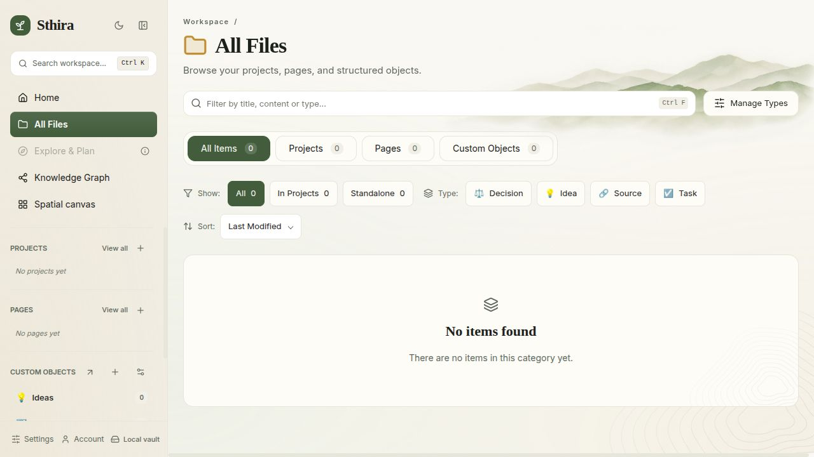

</details>

Product screenshots are documentation assets, not a product-wide acceptance report. Refresh them from the current running interface using synthetic data, inspect each final image, state its execution layer, and keep incidental logs/QA output in ignored `tmp/verification/`.
